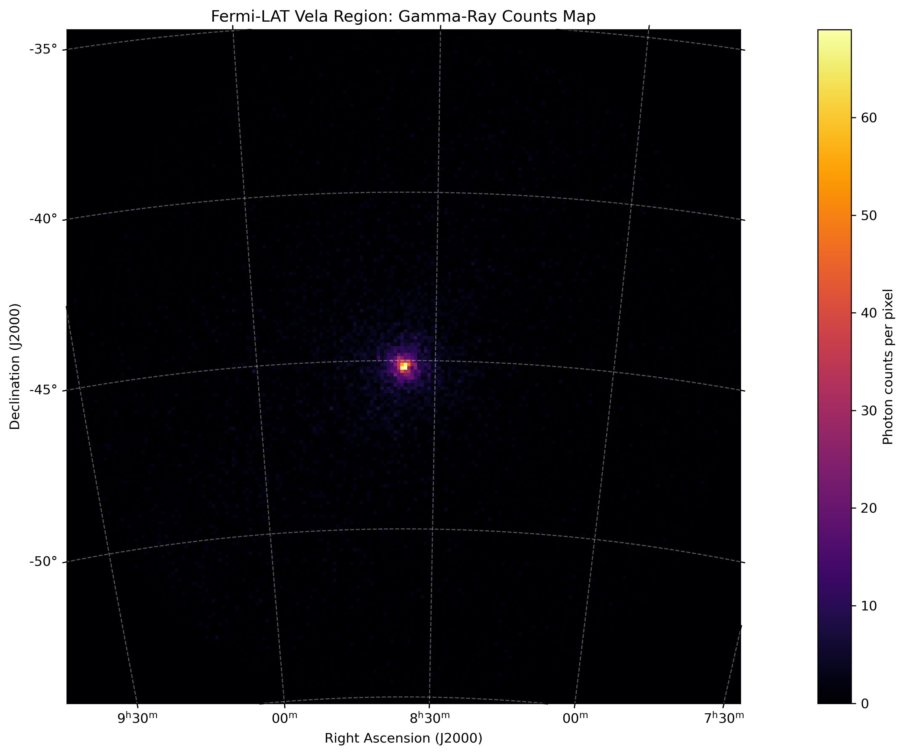
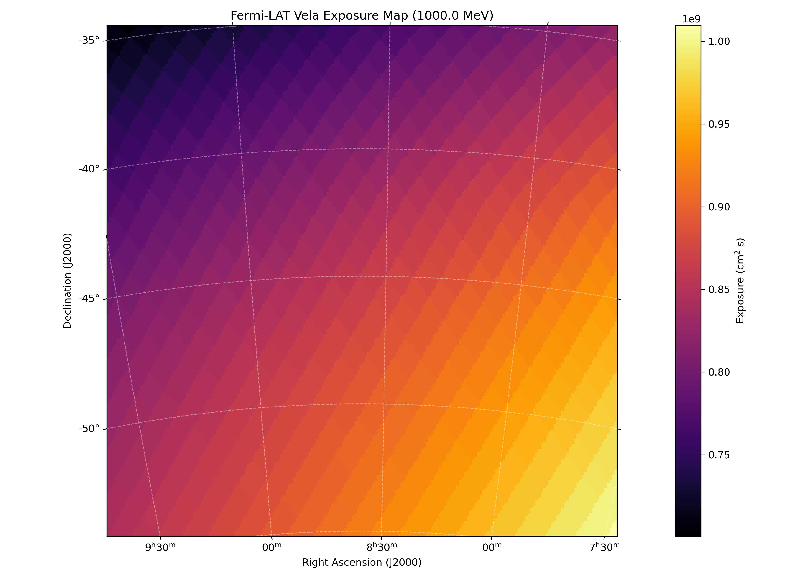

# Fermi-LAT Gamma-Ray Data Analysis of the Vela Pulsar

**An independent computational astrophysics research project using data from NASA's Fermi Gamma-ray Space Telescope.**

## 1. Overview

This project investigates gamma-ray observations of the Vela pulsar using data from the **Fermi Large Area Telescope (Fermi-LAT)**.

The primary objective is to develop a reproducible gamma-ray data analysis workflow, beginning with photon-event selection and instrument exposure calculations, followed by source modelling and maximum-likelihood analysis.

The project uses NASA's Fermi Science Tools, Fermipy, Python and Astropy to process and examine gamma-ray observations.

## 2. Scientific Objectives

The project aims to:

- Process Fermi-LAT Pass 8 photon-event data.
- Apply scientifically appropriate event and time-quality selections.
- Construct spatial and energy-resolved gamma-ray counts maps.
- Calculate livetime and instrument exposure.
- Model the Vela pulsar and nearby gamma-ray sources.
- Account for Galactic and isotropic diffuse emission.
- Perform maximum-likelihood spectral analysis.
- Estimate source flux, spectral parameters and detection significance.

## 3. Target and Observation Parameters

| Parameter | Value |
|---|---|
| Target | Vela Pulsar |
| Catalogue designation | 4FGL J0835.3-4510 |
| Right Ascension | 128.836° |
| Declination | −45.176° |
| Coordinate system | ICRS / J2000 |
| Region of Interest | 10° |
| Energy range | 100 MeV – 100 GeV |
| Observation start | 2024-01-01 UTC |
| Observation end | 2024-01-08 UTC |
| Event class | P8R3 SOURCE |
| Event type | FRONT + BACK |
| Zenith angle selection | 90° |
| Instrument Response Functions | P8R3_SOURCE_V3 |
| Source catalogue | 4FGL-DR4 |

## 4. Data Sources

The observational data were obtained from the NASA Fermi Science Support Center.

**Data products:**
- PH00: Photon event data.
- SC00: Spacecraft data.
- 4FGL-DR4: Fourth Fermi-LAT source catalogue, Data Release 4.

**Fermi data query ID:**

`L260715124040DDAC6B9822`

The original FITS datasets are not included in this GitHub repository because of their size. Users should obtain the corresponding data products from the Fermi Science Support Center.

The analysis also uses the following diffuse emission templates:

- Galactic diffuse emission: `gll_iem_v07.fits`
- Isotropic diffuse emission: `iso_P8R3_SOURCE_V3_v1.txt`

These templates are distributed through the Fermi Science Tools reference data.

## 5. Methodology and Processing Pipeline

The analysis is organised into the following stages:

### Stage 1 — Data Acquisition

Download photon-event and spacecraft data from the Fermi Science Support Center.

### Stage 2 — Event Selection

Use `gtselect` to select events based on:

- Spatial region around Vela.
- Energy range.
- P8R3 SOURCE event class.
- FRONT and BACK event types.
- Zenith angle constraint.

### Stage 3 — Good Time Interval Filtering

Use `gtmktime` to apply spacecraft data quality requirements:

`(DATA_QUAL>0)&&(LAT_CONFIG==1)`

### Stage 4 — Counts Map Generation

Use `gtbin` to generate spatial and energy-resolved counts products.

### Stage 5 — Livetime Calculation

Use `gtltcube` to calculate the instrument livetime distribution over the observation period.

### Stage 6 — Exposure Calculation

Use `gtexpcube2` to generate energy-dependent instrument exposure maps using the selected instrument response functions.

### Stage 7 — Source Modelling

Prepare the 4FGL-DR4 source catalogue, nearby extended-source templates and diffuse background models.

### Stage 8 — Likelihood Analysis

The planned analysis uses a maximum-likelihood framework to estimate the spectral properties of the Vela pulsar and assess the contributions of surrounding sources.

## 6. Current Processing Results

The following processing results have been obtained:

| Product | Result |
|---|---|
| Selected photon events | 13,655 |
| Good Time Intervals | 101 |
| Total GTI duration | 134.376 hours |
| Spatial counts map | 200 × 200 pixels |
| Energy-resolved counts cube | 30 energy bins |
| Livetime cube | Generated |
| Full exposure cube | 30 energy intervals |
| 14° exposure cube | Generated |
| Energy and spatial consistency checks | Passed |

These are data-processing results, not fitted source measurements.

## 7. Visualisations

### Vela Gamma-Ray Counts Map

### Instrument Exposure at 1 GeV

### Publication-Style Exposure Visual
